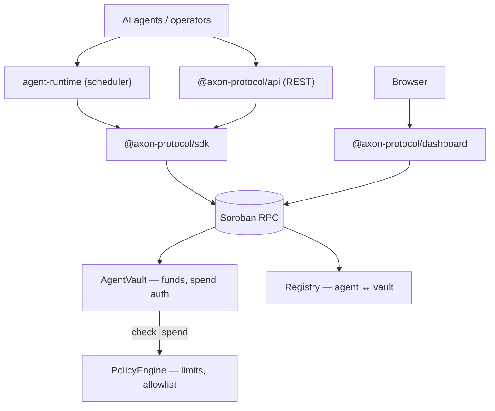

# Axon Protocol

> Decentralized **Agentic Banking** infrastructure on Stellar — the financial nervous system for autonomous AI agents.

Axon Protocol gives AI agents independent spending power while enforcing strict, human-defined guardrails through on-chain policy contracts. It bridges the high-speed autonomous agent economy with institutional-grade financial security.

Every spend is authorized on-chain: the vault asks the policy engine before it moves a single stroop, and the whole flow is observable from the dashboard.

---

## Status

- **Deployed on Stellar Testnet.** Contracts are live, initialized, and wired together; a policy-checked spend has been executed and confirmed. See [Example Testnet deployment](#example-testnet-deployment).
- **CI** runs contract compilation, Rust/TypeScript lint and tests on every PR, and deploys + executes an end-to-end spend on `main` and on manual dispatch.
- **Contracts are unchanged in behaviour** — the vault calls the policy engine on every `spend`, violations revert on-chain.

---

## Architecture



### Components

| Package | Description |
|---|---|
| `contracts/agent-vault` | Soroban contract — holds agent funds, calls the policy engine on every spend |
| `contracts/policy-engine` | Soroban contract — per-tx limits, period caps, recipient allowlists |
| `contracts/registry` | Soroban contract — on-chain agent ↔ vault directory |
| `packages/sdk` | TypeScript SDK — `AgentVaultClient`, `RegistryClient` |
| `packages/api` | Express REST gateway — spend and registration endpoints |
| `packages/agent-runtime` | Agent execution environment — scheduler, plugin system, spend executor |
| `packages/dashboard` | Next.js app — reads live vault, policy and spend history from chain |
| `scripts/` | Contract build, deployment and end-to-end test helpers |

---

## Quick Start

### Prerequisites

| Tool | Version |
|---|---|
| Node.js | ≥ 20 |
| Rust | stable + `rustup target add wasm32-unknown-unknown` |
| Stellar CLI | tested with 30.0.1 (CI pins it) — [install](https://developers.stellar.org/docs/tools/cli/install-cli) |

### Setup

```bash
# 1. Clone and install
git clone https://github.com/Axon-Logic/axon-protocol
cd axon-protocol
npm install

# 2. Build contracts (wasm) and every TypeScript package
npm run build

# 3. Deploy and initialize on Testnet
#    Generates + Friendbot-funds identities and writes contract IDs to .env
npm run deploy:testnet

# 4. Verify with a real policy-checked spend on chain
npm run test:e2e

# 5. Open the dashboard (live vault state at http://localhost:3000)
npm run dev:dashboard

# 6. Optional: API gateway and agent runtime
#    The API defaults to port 3000, which the dashboard also uses — give it
#    its own port when running both: API_PORT=3100 npm run dev:api
npm run dev:api
npm run dev:runtime
```

> `npm run deploy:testnet` compiles in the required order and initializes all
> three contracts (vault → policy engine link, vault policy, agent registry
> entry). Re-running it deploys a fresh set of contracts and rewrites `.env`.

---

## Commands

| Command | What it does |
|---|---|
| `npm run build` | Contracts to wasm, then all TypeScript packages |
| `npm run build:contracts` | Build `policy-engine` first, then `registry` + `agent-vault` |
| `npm run build:ts` | SDK, then every TypeScript workspace |
| `npm test` | `cargo test` + all TypeScript suites |
| `npm run test:contracts` | Rust unit tests |
| `npm run test:ts` | Jest suites |
| `npm run test:e2e` | Real deposit + policy-checked spend on Testnet |
| `npm run lint` | `cargo fmt --check`, `cargo clippy -D warnings`, `tsc --noEmit`, ESLint |
| `npm run deploy:testnet` | Deploy, initialize and wire all contracts |
| `npm run dev:dashboard` / `dev:api` / `dev:runtime` | Start each app |

Build order matters: `agent-vault` imports `policy_engine.wasm` at compile time, so the policy engine is always built first. See [CONTRIBUTING.md](CONTRIBUTING.md) for the full development guide.

---

## Deployment

`contracts/deploy.sh` (also `npm run deploy:testnet`) is idempotent and performs the whole flow:

1. Generates three identities in the Stellar CLI key store (owner, agent, recipient) and funds each via Friendbot.
2. Compiles all three contracts to wasm.
3. Deploys each contract and captures its ID.
4. Initializes them: `policy-engine(admin)`, `registry(admin)`, then `agent-vault(owner, agent, policy_engine, token)`, where `token` is the native XLM Stellar Asset Contract.
5. Sets the vault's spend policy and registers the agent in the registry.
6. Writes the resulting IDs and addresses to `.env`.

### Example Testnet deployment

Contract IDs are regenerated on every deploy; these come from a verified run:

| Contract | ID |
|---|---|
| AgentVault | [`CAG6YIMBLWW5D3X3J5JRHHIKGYNGLUD3DLCRW2AQ7M32ZEYX4D5FZBTR`](https://stellar.expert/explorer/testnet/contract/CAG6YIMBLWW5D3X3J5JRHHIKGYNGLUD3DLCRW2AQ7M32ZEYX4D5FZBTR) |
| PolicyEngine | [`CDYYXOFUL5SHZPDRATDTVZKOYCMJNZGPOISC4BGHGC2QCTD3WGGRDOMJ`](https://stellar.expert/explorer/testnet/contract/CDYYXOFUL5SHZPDRATDTVZKOYCMJNZGPOISC4BGHGC2QCTD3WGGRDOMJ) |
| Registry | [`CA75TNCZ2BBB72U6HXY5TM4ECA4RUIFXMFZJ4URE6KGROXDGGQ5AOTPX`](https://stellar.expert/explorer/testnet/contract/CA75TNCZ2BBB72U6HXY5TM4ECA4RUIFXMFZJ4URE6KGROXDGGQ5AOTPX) |

Confirmed policy-checked spend: [`29030cdd09ffe5150aa097b9303d2ac6643e13e038cf49545b8763a90cababeb`](https://stellar.expert/explorer/testnet/tx/29030cdd09ffe5150aa097b9303d2ac6643e13e038cf49545b8763a90cababeb)

### End-to-end test

`npm run test:e2e` funds the vault, executes an in-policy spend as the agent, polls both transactions to confirmed on-chain status, prints explorer links, and then simulates an over-limit spend to prove the policy engine rejects it (simulation only — no funds move). It needs a `.env` from `deploy:testnet`.

---

## Dashboard

`packages/dashboard` is a read-only window onto the deployed contracts. Per vault it shows:

- live balance, owner/agent/token config, and the policy limits,
- **spend history** decoded from the vault's own `spend` contract events, with a link to each transaction,
- a link to the contract on the Stellar explorer.

It reads chain state directly from Soroban RPC in its own Next.js route handlers (`/api/vaults/[contractId]/balance`, `.../config`, `.../policy`, `.../spends`, `/api/deployment`), resolving contract IDs from the environment and falling back to the repo-root `.env`, so it works without the Express API running. Each read fails independently — one bad RPC call degrades a card instead of blanking the page.

Spend history is bounded by the RPC's event retention window (roughly the last ~9,000 ledgers), and the UI says so rather than implying a vault never spent.

---

## API

`packages/api` exposes the write path and a thin read layer:

| Method | Route | Purpose |
|---|---|---|
| `GET` | `/health` | Liveness probe |
| `GET` | `/agents/:address` | Registry record for an agent |
| `POST` | `/agents/register` | Register an agent and its vault |
| `GET` | `/vaults/:contractId/balance` | Vault balance |
| `POST` | `/vaults/:contractId/spend` | Submit an agent spend |

Policy changes are made on-chain via `stellar contract invoke` or the SDK, not through the API.

---

## Core Concepts

**AgentVault** — Each agent gets a dedicated vault contract holding its allocated funds. The agent can only spend within the bounds set by its policy.

**PolicyEngine** — Human operators define guardrails: max spend per transaction, cumulative period limits, and optional recipient allowlists. The vault calls the policy engine on every spend — violations revert on-chain.

**Registry** — A permissioned on-chain directory mapping agent addresses to their vaults and off-chain metadata. Enables discovery and deactivation.

**Agent Runtime** — Off-chain execution environment that polls for tasks, executes them via the SDK, and supports a plugin system for custom agent behaviors.

---

## Configuration

Copy `.env.example` to `.env`, or let `npm run deploy:testnet` populate the contract IDs and addresses for you. The main variables:

| Variable | Used by |
|---|---|
| `STELLAR_NETWORK`, `STELLAR_RPC_URL`, `STELLAR_HORIZON_URL`, `STELLAR_NETWORK_PASSPHRASE` | deployment, e2e, dashboard |
| `STELLAR_EXPLORER_BASE` | dashboard explorer links |
| `AGENT_VAULT_CONTRACT_ID`, `POLICY_ENGINE_CONTRACT_ID`, `REGISTRY_CONTRACT_ID`, `NATIVE_TOKEN_CONTRACT_ID` | SDK consumers, dashboard |
| `AXON_OWNER_ADDRESS` / `AXON_AGENT_ADDRESS` / `AXON_RECIPIENT_ADDRESS` | e2e, dashboard simulation source |
| `POLICY_MAX_PER_TX`, `POLICY_MAX_PER_PERIOD`, `POLICY_PERIOD_LEDGERS` | policy set at deploy time |
| `API_PORT`, `NEXT_PUBLIC_API_URL` | API and dashboard write proxies |

Never commit `.env` — it is gitignored.

---

## Contributing

Issues and pull requests are welcome. Start with [CONTRIBUTING.md](CONTRIBUTING.md), and note the [Code of Conduct](CODE_OF_CONDUCT.md).

---

## License

MIT © AxonLogic
